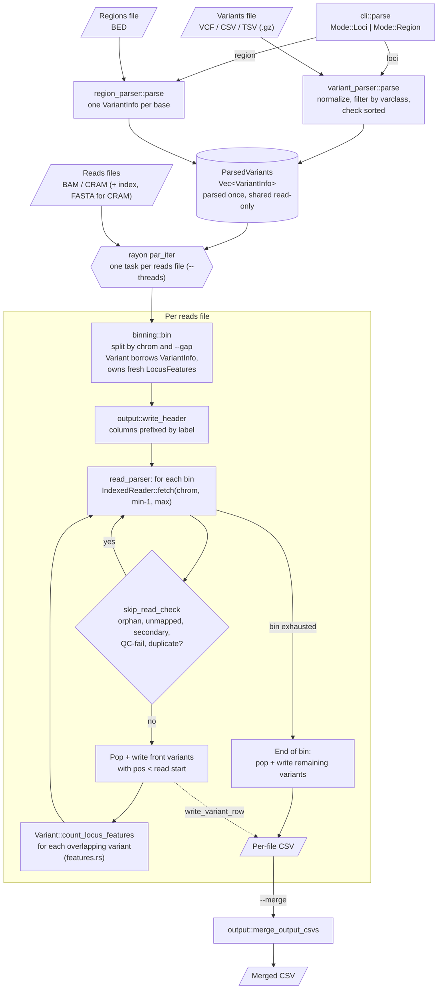

# Architecture

rust-varlap computes per-locus read QC statistics for variants (`loci` mode) or every base in a set of regions (`region` mode) from BAM/CRAM files, writing one CSV per reads file.

## Entry point

`src/main.rs`: `main()` sets up `tracing` logging and calls `run()`. If `run()` fails with an `AppError`, `main()` prints it and exits with that error's exit code; any other error exits with 1.

`run()` reads the CLI (`src/cli.rs`) and picks one of two subcommands:

- **`loci`**: takes a variants file (VCF/CSV/TSV, optionally gzipped), a variant class (`snv` or `indel`) and an `--alleles` mode (`strict`, `partial` or `none`).
- **`region`**: takes a BED file of regions.

Both share `CommonArgs`: reads files, output path, FASTA (for CRAM), sample, labels, `--gap`, `--merge` and `--threads`.

## Modules

| Stage | Module | Role |
|---|---|---|
| Input | `reader.rs` | Opens input files and checks the first two bytes to decide if a file is gzipped |
| Parse | `variant_parser.rs` | Reads VCF/CSV/TSV, normalizes REF/ALT, filters by variant class, requires sorted input |
| Parse | `region_parser.rs` | Turns each BED region into one record per base |
| Data model | `variant.rs` | `VariantInfo`, `Variant<'a>`, `VariantBin`, `ParsedVariants`, `BinnedVariants`, `VarClass`/`VarType` |
| Bin | `binning.rs` | Groups variants by chromosome, splitting where the distance between neighbours exceeds `gap` (default 100 kb) |
| Scan | `read_parser.rs` | Opens BAM/CRAM with an index, fetches reads for each bin, filters reads, drives counting |
| Count | `features.rs` | Per-locus statistics: `ReadFeatures` (shared), `LocusFeaturesSnv`, `LocusFeaturesIndel` |
| Output | `output.rs` | Output paths, the header row, one CSV row per variant, and the optional merge |
| Errors | `errors.rs` | `AppError` (thiserror), its exit codes, and how each error is printed |

## Data flow

## Key design points

- **It loops over reads, not pileups.** Each bin is a queue of variants sorted by position (a `VecDeque`). Once a read starts past a variant, no later read can cover that variant, so its row is written and it's dropped from the queue. This is why both the variants/BED and reads files must be coordinate-sorted.
- **Each reads file gets its own copy of the counters.** `binning::bin` runs separately for every reads file and borrows from the shared `ParsedVariants`, so threads never share mutable state.
- **Bins limit index lookups.** A bin covers variants on one chromosome with no gap larger than `--gap` between neighbours, and each bin gets a single indexed `fetch`. A small gap suits sparse variants; a large gap suits dense ones.
- **Region mode is built on the SNV path.** Every base in a BED region becomes a `VariantInfo` with no REF/ALT and `VarType::Unknown`, processed with `VarClass::Snv`. A large BED file therefore creates millions of records before any reads are scanned. This is the known memory issue; the planned fix is batching, e.g. expanding regions one bin at a time.
- **Two kinds of errors.** Known failure cases, such as unsorted input, a missing CRAM reference or a truncated reads file (10 read errors in a row), are `AppError` variants with exit codes. Everything else uses `anyhow` with added context.
- **Parity with Python varlap.** Read filtering in `skip_read_check` mirrors the pysam pileup defaults used by the original tool. Output values should match it, though the header labels differ on purpose (`ref_avg_nm` rather than `ref avg nm`).
