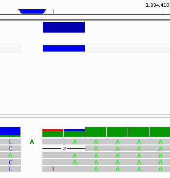
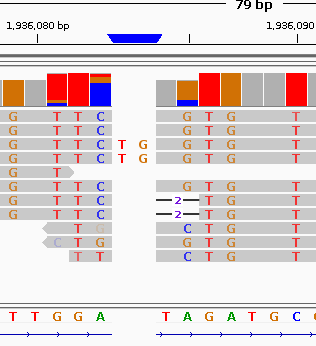
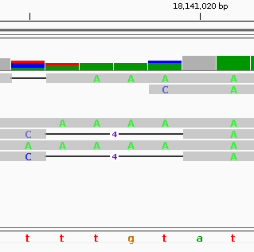
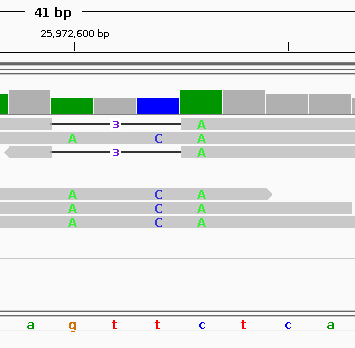

We have these two variants which share the same POS and REF, and have been parsed using `bcftools norm -Oz`

```
chrom,pos,ref,alt,vartype,pos_normalized,sample,depth, ref_count, alt_count, other_count, alt_vaf, overlapping_indels_count, ...
11,1334404,CAA,C,DEL,0.009883997006485228,,5,1,1,3,0.2,2,0.0,24.0,60.0,...
11,1334404,CAA,CAAA,INS,0.009883997006485228,,5,3,0,2,0.0,0,1.0,...
```



Looking at IGV, there is one DEL that represents the CAA -> C.
However, there is also an insertion C -> CA, whch is represented as CAA -> CAAA.

In our program, we calculate the start of an INDEL using
```
    // get the genome coordinates of where an INDEL variant will actually
    // start, as opposed to the location of where the variant is reported
    // the starting position must take into account the context bases that
    // are given when the variant is reported in the VCF file.
    // Note: if we assume normalized biallelic variants, could just do (pos + 1)
    pub fn get_indel_start_coord(&self, pos: u64, refr: &str, alt: &str) -> u64 {
        let shortest_len = cmp::min(refr.len(), alt.len());
        pos + shortest_len as u64
    }
```

In the original varlap
https://github.com/bjpop/varlap/blob/db1a1d144134038c2676e70b1dbbe125d8d623b6/varlap/varlap.py#L604
```
def get_indel_start_coord(pos, ref, alt):
    len_ref = len(ref)
    len_alt = len(alt)
    shortest_len = min(len_ref, len_alt)
    return pos + shortest_len
```
Also note that it has an assumption that the reference allele is only 1 base (so the bases of the alt it gets would be AAA)
https://github.com/bjpop/varlap/blob/db1a1d144134038c2676e70b1dbbe125d8d623b6/varlap/varlap.py#L633
```
        elif len(alt) > len(ref):
            self.indel_type = "INS"
            self.bases = alt[1:]
```

As such, the second INS is misrepresented when we are trying to find overlapping variants.

The INS should be C -> CA, however our algorithm will classify the INS as A -> AA. This will not count as overlapping the variant and thus causes the output to be wrong.

What are the options to fix this?
It seems like this may happen if some variants in the VCF are multiallelic; for variants that have an anchoring base at the same position, some of the variants may not be processed correctly (e.g. the example seen previously)
NOTE: this may also cause some SNVs to not be processed properly as our parser only deems SNVs acceptable if their length is 1.
To fix this we can either:
- Require normalized parsimonous, left-aligned VCFs only where multiallelic variants have been split into separate biallelic rows `bcftools norm -m -any`
- Create a function that normalizes a variant when parsing

```
fn process_variant_row(
    row: &VariantRow,
    varclass: &VarClass,
    variants: &mut Vec<VariantInfo>,
    skipped: &mut SkippedVariants,
) -> Result<()> {
    for alt in &row.alts {
        
        INSERT NORMALIZED REF/ALT FUNCTION HERE

        let vartype = get_var_type(&row.refr, alt);
```

QUICK CLAUDE MOCKUP

```
/// Left-align and minimize a REF/ALT pair. `pos` is 1-based on input and output.
fn normalize_indel(mut pos: u64, refr: &str, alt: &str) -> (u64, String, String) {
    let mut r: Vec<u8> = refr.bytes().collect();
    let mut a: Vec<u8> = alt.bytes().collect();

    // Trim shared suffix first, while both retain at least 1 base
    while r.len() > 1 && a.len() > 1 && r.last() == a.last() {
        r.pop();
        a.pop();
    }

    // Then trim shared prefix, advancing pos for each base removed
    let mut trim_front = 0;
    while r.len() - trim_front > 1 && a.len() - trim_front > 1 && r[trim_front] == a[trim_front] {
        trim_front += 1;
    }
    pos += trim_front as u64;

    (
        pos,
        String::from_utf8(r[trim_front..].to_vec()).unwrap(),
        String::from_utf8(a[trim_front..].to_vec()).unwrap(),
    )
}
```

NOTE: the example above was done using a simple bcftools mpileup + call

I have tried a more standardized variant calling workflow to compare; using nf-core/Sarek and HaplotypeCaller

```
nextflow run nf-core/sarek -r 3.10.0 \
    --input samplesheet.csv \
    --step variant_calling \
    --tools haplotypecaller \
    --genome GATK.GRCh37 \
    --intervals chr11.bed \
    -profile docker \
    --outdir results \
```

Where the bed file is just for chr11 contig in the `HG00096.chrom11.ILLUMINA.bwa.GBR.low_coverage.bam`

```
printf '11\t0\t135006516\n' > chr11.bed
```

We can find some variants in the resulting VCF that will trouble our algorithm; for example:

```
#CHROM  POS     ID      REF     ALT     QUAL    FILTER  INFO
11      1936083 rs139159285     CTG     C,CTGTG 188.02  PASS
11      18141015        rs10832883;rs3072438    CAAAA   C,AAAAA 179.06  PASS
11      25972599        rs71447442;rs35791832   AATCATCATC      A,AATCATC PASS
```



The first example is the same as our previous one; the insertion should be C -> CTG, but instead it is recognized as G -> GTG



The second example is an example of a SNV that would be skipped; CAAAA -> AAAAA should be a SNV of C -> A, but since its length is > 1 we don't classify it as an SNV when it should



The third example is a deletion CATC -> C when it should be AATC -> A instead

It seems as though these issues mainly arise when there are multiallelic calls of tandem repeats.

Running the above mockup for normalizing the multiallelic variants, we should get:
```
chrom,pos,ref,alt,vartype
11,1936083,CTG,C,DEL
11,1936083,C,CTG,INS

11,18141015,CAAAA,C,DEL
11,18141015,C,A,SNV

11,25972599,AATCATCATC,A,DEL
11,25972599,AATC,A,DEL
```

Another note; varlap currently support delins example below
```
2026-09-20T00:38:56.117233Z  WARN rust_varlap::variant_parser: Cannot determine the type of variant with ref:CA and alt:AG
2026-09-20T00:38:56.117255Z  WARN rust_varlap::variant_parser: Cannot determine the type of variant with ref:GTG and alt:CAT
```

Also, it may misclassify delins as indels, or being unable to determine SNVs
```
2026-09-20T00:38:56.109056Z  WARN rust_varlap::variant_parser: Cannot determine the type of variant with ref:CAA and alt:AAA
```

To fix this, we can maybe implement these steps:
- normalize the variant (instead of running it on every variant, we only run it when alt or ref is > 1)
    - this will find SNVs that are represented as MNVs, while also separating INDELS from DELINS
    - i.e for a true INDEL, ref or alt will be of length 1
- we can then redo our classification
    - if both ref and alt len = 1, SNV
    - elif ref = 1 & alt > 1, OR ref > 1 & alt = 1, INDEL
    - elif both ref and alt len > 1, DELIN
    - else, UNKNOWN (e.g. empty ref/alt as we have set them to be optional in our feature counts (need to implement in variant parser/binning))

For DELINS, we can reuse the INDEL feature count, but instead of walking the CIGAR string it may be better to just compare the reads where the position of the variant spans directly.
